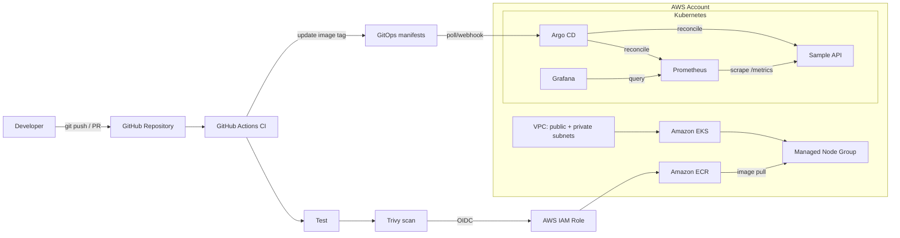

# Internal Developer Platform on AWS EKS

A compact, production-inspired Internal Developer Platform (IDP) reference implementation built to demonstrate the platform-engineering decisions interviewers usually ask about: infrastructure provisioning, Kubernetes, GitOps, CI/CD separation, software supply-chain controls, observability, identity, networking, cost, and trade-offs.

> **Scope:** This is a learning/portfolio implementation, not a claim of prior production deployment. It is deliberately small enough for one engineer to build and explain end-to-end.

## What this project proves

- Terraform provisions a VPC, EKS cluster, managed node group, ECR repository, and GitHub Actions OIDC IAM role.
- Argo CD owns continuous delivery to Kubernetes using Git as the source of truth.
- Prometheus + Grafana provide cluster and application observability.
- A sample FastAPI microservice exposes `/health`, `/ready`, and `/metrics`.
- GitHub Actions performs **build → test → container scan → push → GitOps manifest update**.
- Kubernetes deployment uses probes, resource requests/limits, rolling updates, pod security settings, and a ServiceMonitor.
- Architecture decisions and trade-offs are documented instead of hidden in code.

## Architecture



See [docs/architecture.md](docs/architecture.md) for the one-page explanation and [docs/tradeoffs.md](docs/tradeoffs.md) for design decisions.

## Repository layout

```text
.
├── .github/workflows/          # CI and Terraform validation
├── bootstrap/                  # One-time Argo CD bootstrap
├── docs/                       # Architecture, trade-offs, interview guide
├── gitops/                     # Desired state consumed by Argo CD
│   ├── apps/sample-api/
│   ├── bootstrap/
│   └── platform/monitoring/
├── infra/terraform/            # AWS infrastructure
├── sample-service/             # FastAPI app + tests + Dockerfile
└── scripts/                    # Helper scripts
```

## Prerequisites

Install:

- AWS CLI v2
- Terraform >= 1.5.7
- kubectl
- Helm 3
- Git
- Docker (only required for local image builds)
- An AWS account with permission to create VPC/EKS/IAM/ECR resources
- A GitHub repository containing this project

AWS EKS 1.36 is used by default because it is a currently available EKS Kubernetes version. Change `cluster_version` when your organization standardizes another supported version.

## 1. Configure Terraform

```bash
cd infra/terraform
cp terraform.tfvars.example terraform.tfvars
```

Edit at least:

```hcl
aws_region  = "ap-south-1"
project_name = "idp-demo"
github_org   = "bonganiajay26"
github_repo  = "internal-developer-platform"
```

Then run:

```bash
terraform init
terraform fmt -check
terraform validate
terraform plan
terraform apply
```

Important outputs:

```bash
terraform output cluster_name
terraform output ecr_repository_url
terraform output github_actions_role_arn
```

## 2. Configure kubectl

```bash
aws eks update-kubeconfig \
  --region ap-south-1 \
  --name "$(terraform -chdir=infra/terraform output -raw cluster_name)"

kubectl get nodes
```

## 3. Configure GitHub Actions

Create these GitHub repository **Variables**:

- `AWS_REGION` — e.g. `ap-south-1`
- `ECR_REPOSITORY` — Terraform output `ecr_repository_name`

Create this GitHub repository **Secret**:

- `AWS_ROLE_ARN` — Terraform output `github_actions_role_arn`

The workflow uses GitHub OIDC, so there are no long-lived AWS access keys in GitHub.

## 4. Bootstrap Argo CD

```bash
./bootstrap/install-argocd.sh
```

This installs Argo CD and applies the root `Application`, which then manages the sample application and monitoring stack.

The GitOps repository URL is preconfigured for `bonganiajay26/internal-developer-platform`. After Terraform creates ECR, configure the image repository before the first Argo sync:

```bash
./scripts/configure-gitops.sh "$(terraform -chdir=infra/terraform output -raw ecr_repository_url)"
```

Commit and push that manifest change, then run the bootstrap script.

## 5. Observe GitOps reconciliation

```bash
kubectl get applications -n argocd
kubectl get pods -A
kubectl get svc -n sample-api
```

Argo CD is intentionally the only component that performs deployment. GitHub Actions changes Git; Argo CD changes Kubernetes.

## 6. Run the CI/CD flow

Change `sample-service/app.py` and push to `main`.

The pipeline performs:

1. Python dependency install
2. Unit tests
3. Docker build
4. Trivy vulnerability scan
5. AWS authentication with GitHub OIDC
6. Push image to Amazon ECR using the immutable commit SHA tag
7. Update the Kustomize image in the GitOps overlay
8. Commit the manifest change back to Git
9. Argo CD detects drift and reconciles EKS

This creates a clear audit chain:

```text
source commit -> CI run -> image SHA tag -> GitOps commit -> Argo CD sync -> Kubernetes revision
```

## 7. Access Prometheus and Grafana

For a local demo, port-forward rather than exposing dashboards publicly:

```bash
kubectl -n monitoring port-forward svc/kube-prometheus-stack-grafana 3000:80
kubectl -n monitoring get secret kube-prometheus-stack-grafana \
  -o jsonpath='{.data.admin-password}' | base64 -d; echo
```

Open `http://localhost:3000` locally.

## Security decisions

- **OIDC instead of AWS access keys:** CI receives short-lived AWS credentials.
- **Private worker nodes:** nodes run in private subnets; the public EKS endpoint is enabled only for a low-friction demo and can be restricted by CIDR or disabled.
- **ECR immutable tags:** CI publishes commit-SHA tags; no `latest` deployment dependency.
- **Container scan gate:** Trivy fails CI on HIGH/CRITICAL vulnerabilities.
- **Non-root workload:** the sample deployment enables a restricted security context.
- **GitOps pull model:** deployment credentials do not need to be embedded in CI.

## Reliability decisions

- Managed node group spans multiple AZs.
- Liveness/readiness probes prevent unhealthy pods from receiving traffic.
- Two application replicas demonstrate rolling deployment behavior.
- PodDisruptionBudget limits voluntary disruption.
- Resource requests/limits make scheduling and saturation visible.
- Argo CD automated sync includes prune + self-heal.

## Cost controls

This demo intentionally uses:

- one managed node group
- small general-purpose instances
- a single NAT gateway to reduce demo cost
- no public load balancer by default
- no managed Prometheus/Grafana services

For production, a single NAT gateway is a resilience trade-off; use one per AZ when availability justifies the cost.

## Key trade-offs

| Decision | Why chosen here | Production alternative |
|---|---|---|
| EKS managed node groups | Easy to understand and operate | Karpenter / EKS Auto Mode for dynamic capacity |
| Terraform modules | Faster, reusable, interview-friendly | Internal opinionated modules with policy tests |
| Public EKS API enabled | Easier individual demo access | Private endpoint + VPN/Direct Connect/bastion |
| Single NAT gateway | Lower demo cost | NAT per AZ for HA |
| GitHub Actions writes manifest | Simple complete CI→GitOps loop | Dedicated config repo + PR/promotion controller |
| Argo auto-sync | Fast demo feedback | Promotion gates/manual sync for sensitive prod |
| kube-prometheus-stack | Complete OSS observability | AMP/AMG, Datadog, Dynatrace, New Relic, etc. |
| One cluster/environment | Low cost and easy teardown | Separate accounts/clusters based on isolation needs |

More detail: [docs/tradeoffs.md](docs/tradeoffs.md).

## Interview walkthrough

Use this 5-minute storyline:

> “I built a small internal developer platform on AWS. Terraform creates the VPC, EKS, ECR and federated CI identity. Developers push code to GitHub. GitHub Actions tests and scans the service, publishes an immutable image to ECR, and updates Git desired state. Argo CD, not CI, reconciles that desired state into EKS. Prometheus scrapes both platform and application metrics, and Grafana visualizes them. I deliberately kept the demo inexpensive, so I used a single NAT gateway and managed node group; in production I would change those based on RTO, availability, and workload profile.”

Then answer questions from [docs/interview-guide.md](docs/interview-guide.md).

## Local test

```bash
cd sample-service
python -m venv .venv
source .venv/bin/activate
pip install -r requirements.txt
pytest -q
uvicorn app:app --reload --port 8080
```

Test:

```bash
curl http://localhost:8080/health
curl http://localhost:8080/ready
curl http://localhost:8080/metrics
```

## Teardown

Delete GitOps-managed workloads first, then infrastructure:

```bash
kubectl delete -f gitops/bootstrap/root-app.yaml --ignore-not-found
helm uninstall argocd -n argocd || true
terraform -chdir=infra/terraform destroy
```

Check for AWS resources such as ECR images or load balancers if deletion is blocked.

## Improvements for a second iteration

- AWS Load Balancer Controller + external-dns + TLS
- External Secrets Operator + AWS Secrets Manager
- Kyverno/Gatekeeper policy-as-code
- Cosign image signing and admission verification
- SBOM generation and provenance attestations
- Argo Rollouts for canary/blue-green delivery
- Karpenter for elastic nodes
- Loki/Tempo/OpenTelemetry
- Backstage developer portal and golden-path templates
- Multi-account dev/stage/prod promotion
- Terraform remote state with S3 + locking

## License

MIT — see [LICENSE](LICENSE).

## Backstage developer portal

Backstage is the **developer-experience and self-service layer**. It exposes the software catalog and golden paths; Terraform still provisions infrastructure, GitHub Actions performs CI, Argo CD performs GitOps deployment, and EKS runs workloads. Starter assets are in `backstage/`; see [`docs/backstage-self-service.md`](docs/backstage-self-service.md).

```text
Developer -> Backstage -> Golden Path -> GitHub -> GitHub Actions -> ECR
                                      \-> GitOps -> Argo CD -> EKS
Backstage -> approved Terraform workflow -> AWS
EKS -> Prometheus -> Grafana
```

