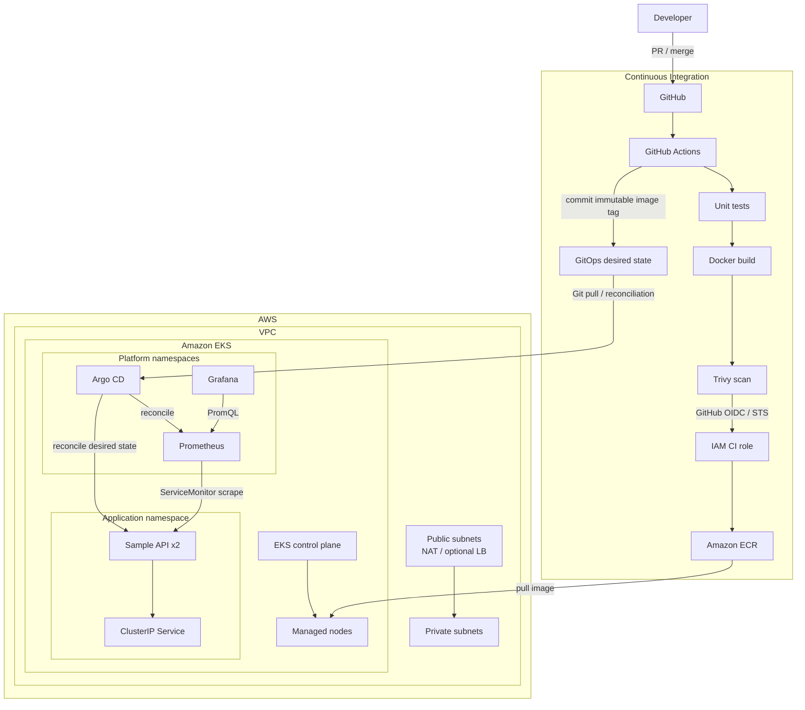

# One-page architecture

## Control-plane story

There are two independent reconciliation loops:

1. **Infrastructure reconciliation:** Terraform compares AWS desired state with AWS actual state and creates/updates the VPC, IAM, ECR, and EKS resources.
2. **Application reconciliation:** Argo CD compares Git desired state with Kubernetes actual state and converges the cluster.

CI does not run `kubectl apply`. This reduces credential sprawl and preserves Git as the deployment audit trail.

## Request/data path

The sample keeps application networking intentionally internal. For a production internet-facing service, add AWS Load Balancer Controller, an ALB ingress, Route 53, ACM TLS, WAF, and a clear public/private API decision.

## Identity path

GitHub Actions uses its OIDC identity token to assume a narrowly scoped AWS IAM role. The role can push only to the project ECR repository. No persistent AWS access key is required in GitHub.

## Observability path

The application exports Prometheus metrics. A `ServiceMonitor` tells Prometheus Operator what to scrape. Grafana queries Prometheus. Kubernetes/node/control-plane signals come from the kube-prometheus-stack components.

## Failure domains

- EKS control plane is AWS managed.
- Worker nodes span multiple AZs through private subnets.
- The demo uses one NAT gateway for cost, which is a deliberate egress availability trade-off.
- Application replicas are spread by the scheduler but strict topology spread constraints can be added for stronger guarantees.
