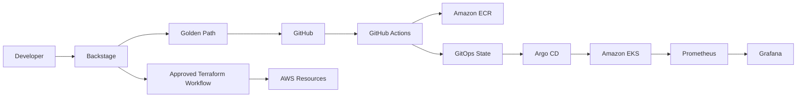

# Backstage self-service layer

Backstage is the front door, not the deployment engine. Developers use the portal to discover services and invoke golden paths. The platform team owns the templates and guardrails.

For production, add SSO/RBAC, a PostgreSQL backend, GitHub App authentication, secret management, policy-as-code, repository protection, approvals for privileged infrastructure requests, and separate dev/stage/prod promotion.
